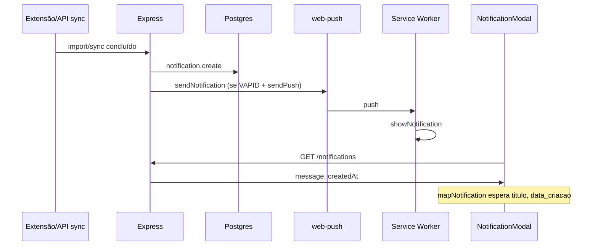

# Plano — performance e notificações (FASE 3)

| Campo | Valor |
|--------|--------|
| **Data** | 24/11/2026 |
| **Método** | Análise estática + desenho de medição. **Nenhuma** alteração de código nem execução de benchmarks nesta fase. |
| **Entradas** | [`auditoria-codigo.md`](auditoria-codigo.md), [`roadmap.md`](roadmap.md) |
| **Regra** | Implementação **só após sua aprovação** do plano de correções; medição **antes/depois** obrigatória. |

---

## 0. Princípio: medir antes de mudar

### 0.1 Ambientes

| Ambiente | Uso |
|----------|-----|
| **Local** | Reproduzir queries, Redis, WS, push (Chrome + VAPID) |
| **Staging/produção** | TTFB real, cold start Render, Vercel edge — **URLs e configs não verificadas nesta sessão** |

Variáveis mínimas para testes locais (você preenche `api/.env`):

- `DATABASE_URL`, `REDIS_URL`, `JWT_SECRET`, `CORS_ORIGIN=http://localhost:3000`
- `VAPID_PUBLIC_KEY` / `VAPID_PRIVATE_KEY` (gerar com `web-push generate-vapid-keys` — **não executado aqui**)
- Chaves TMDB/IGDB se for medir detalhes “live”

### 0.2 Métricas-alvo (definição)

| ID | Métrica | Como medir | Meta inicial (sugestão) |
|----|---------|------------|-------------------------|
| **M1** | TTFB `GET /api/homepage` (cache HIT) | `curl -w time_starttransfer` + header `X-Cache: HIT` | < 150 ms local; < 500 ms prod **não verificado** |
| **M2** | TTFB `GET /api/homepage` (cache MISS) | Forçar MISS (chave nova ou flush Redis) | Baseline documentado; reduzir ≥ 30% após otimização DB |
| **M3** | Tamanho JSON homepage | `curl -s -o /tmp/hp.json -w '%{size_download}'` | Baseline; cortar campos mortos se > ~500 KB |
| **M4** | `GET /api/pesquisa?q=...` | Tempo 3 termos (curto, comum, raro) | < 300 ms local com índice; **sem índice**: baseline alto 🧪 |
| **M5** | Detalhes live `*/details` | 4 tipos, 1 id cada | < 2 s P95 com cache; sem cache documentar |
| **M6** | LCP home (web) | Lighthouse CI ou PageSpeed | **não verificado** — registrar score |
| **M7** | JS bundle home | `@next/bundle-analyzer` ou `next build` log | Baseline **não verificado** |
| **M8** | Frescor pós-sync | Tempo até UI refletir mudança | < 1 min com invalidação correta |
| **M9** | Push E2E | Ver seção 3B.5 | 1 notificação recebida < 10 s |

### 0.3 Baseline — comandos (Linux/macOS)

```bash
# API no ar (você inicia): cd api && npm run dev

# Homepage — cache e tamanho
curl -s -D - -o /tmp/homepage.json http://localhost:3001/api/homepage | grep -iE 'x-cache|cache-control'
wc -c /tmp/homepage.json

# Repetir após 1º request (esperado HIT se Redis up)
curl -s -D - -o /dev/null http://localhost:3001/api/homepage | grep -iE 'x-cache'

# Pesquisa
for q in up one duna; do
  curl -s -o /dev/null -w "q=$q total=%{time_total}\n" "http://localhost:3001/api/pesquisa?q=$q"
done

# Redis — chaves de cache
docker compose exec -T redis redis-cli --scan --pattern 'cache:*' | head -20

# Invalidação (se SYNC_SECRET configurado)
curl -s -X POST http://localhost:3001/api/sync/invalidate-cache \
  -H "x-sync-secret: SEU_SYNC_SECRET" -H 'Content-Type: application/json' \
  -d '{"scope":"all"}'
docker compose exec -T redis redis-cli --scan --pattern 'cache:*' | wc -l

# Postgres — tempo de uma query pesada (exemplo; ajuste)
docker compose exec -T postgres psql -U postgres -d orbe_nerd_db -c '\timing on' -c \
  "EXPLAIN (ANALYZE, BUFFERS) SELECT id FROM \"Filme\" WHERE title ILIKE '%duna%' LIMIT 24;"
```

### 0.4 Baseline — PowerShell

```powershell
powershell.exe -ExecutionPolicy Bypass -Command "curl.exe -s -D - -o $env:TEMP\homepage.json http://localhost:3001/api/homepage"
powershell.exe -ExecutionPolicy Bypass -Command "(Get-Item $env:TEMP\homepage.json).Length"
powershell.exe -ExecutionPolicy Bypass -Command "curl.exe -s -D - -o NUL http://localhost:3001/api/homepage"
powershell.exe -ExecutionPolicy Bypass -Command "foreach ($q in @('up','one','duna')) { curl.exe -s -o NUL -w \"q=$q total=%{time_total}\n\" \"http://localhost:3001/api/pesquisa?q=$q\" }"
powershell.exe -ExecutionPolicy Bypass -Command "docker compose exec -T redis redis-cli --scan --pattern 'cache:*'"
```

### 0.5 Baseline — frontend

```bash
cd frontend && npm run build
# Opcional (após npm install @next/bundle-analyzer se você aprovar):
# ANALYZE=true npm run build
npx --yes lighthouse http://localhost:3000 --only-categories=performance --output=json --output-path=/tmp/lh-home.json
```

**PowerShell (Lighthouse):**

```powershell
powershell.exe -ExecutionPolicy Bypass -Command "Set-Location frontend; npm run build"
powershell.exe -ExecutionPolicy Bypass -Command "npx --yes lighthouse http://localhost:3000 --only-categories=performance --output=json --output-path=$env:TEMP\lh-home.json"
```

---

## 3A — Lentidão

### 3A.1 Causas por evidência (código)

Legenda impacto: **Alto** / **Médio** / **Baixo** (percepção do usuário + carga servidor).  
Risco da correção: **Baixo** / **Médio** / **Alto**.

| Pri | Causa | Evidência | Impacto | Correção proposta | Risco | Medir antes/depois |
|-----|--------|-----------|---------|-------------------|-------|---------------------|
| **1** | **Cache invalidation ineficaz** — dados “velhos” até 12h TTL; parece lentidão ao F5 após sync | `cacheMiddleware`: chave `cache:v4:…`; `cacheInvalidation`: padrão `cache:/api/…*` | **Alto** (frescor) | Prefixar padrões com `cache:v${CACHE_KEY_VERSION}:`; teste automatizado | **Baixo** | M8: após sync admin, homepage JSON muda em < 2 min; contagem chaves Redis |
| **2** | **Homepage `/api/hoje` muitas queries paralelas + includes pesados** | `homeRoutes.ts`: `Promise.all` com dezenas de `findMany` + `cardListInclude` / `animeCarouselInclude` | **Alto** em MISS | Reduzir queries duplicadas; materialized view ou endpoint fragmentado; manter cache 12h (`TWELVE_HOURS=43200`) | **Médio** | M2, M3 nos dois endpoints |
| **3** | **`animeCarouselInclude` com `new Date()` congelado** | `mediaRoutesHelpers.ts:271-272` | **Médio** (dados errados → re-fetch cliente) | Função `getAnimeCarouselInclude(now)` por request | **Baixo** | Comparar `airingSchedule` count no JSON antes/depois de 24h uptime simulado |
| **4** | **Busca `contains` + ILIKE sem índice trigram** | `homeRoutes.ts:526+`; schema sem índice GIN em `title` | **Alto** em catálogo grande | `pg_trgm` + GIN em colunas de título; ou busca dedicada (Meilisearch) — **P2** | **Médio** | M4 antes/depois; `EXPLAIN ANALYZE` |
| **5** | **Cron deals a cada 1 min** compete com HTTP no mesmo processo | `index.ts:321-333`; `dealsService.ts` multi-fetch | **Médio–Alto** em CPU/rede | Intervalo 5–10 min em prod; ou worker separado; manter soft-TTL 60s no GET | **Médio** | CPU load médio API (Render metrics **não verificado**); latência homepage sob cron |
| **6** | **Detetive + Chromium no processo web** | `index.ts:314-317`; cron 03:00 | **Médio** (picos) | Job isolado ou fila; ou horário fixo fora de pico | **Alto** (ops) | Duração `run-detetive`; latência durante execução |
| **7** | **Detalhes live multi-API** (TMDB/AniList/IGDB/Steam) | `externalDetails.ts` (+ rotas `*/details`) | **Alto** por clique | Cache Redis por id; timeout agressivo; devolver stub + loading no FE | **Médio** | M5 por tipo |
| **8** | **SSR vazio / double fetch** | `apiServer.ts` sem `NEXT_PUBLIC_API_URL`; `page.tsx` catch vazio; `FilmesClient` skip 1º fetch | **Alto** (LCP, sensação lenta) | P0.4 roadmap: `getApiOrigin` completo | **Baixo** | M6, filmes: ver se network mostra 2x `/api/filmes` |
| **9** | **`ClientOnly` esconde Header/main no SSR** | `layout.tsx:118-128` | **Alto** (LCP, SEO) | Render estático do shell; só modais client-only | **Médio** | Lighthouse CLS/LCP |
| **10** | **WebSocket falha + reconexão exponencial** | `useSyncSocket.ts:56-61`; `websocket.ts` | **Baixo** latência; **Médio** bateria/rede | Corrigir origem WS (P0.3) ou desligar WS até corrigir | **Baixo** | Contagem conexões WS/min no DevTools |
| **11** | **Polling `/api/sync/status` 8–45 s** | `SyncRefreshListener.tsx:36-50` | **Baixo** | Manter até WS; backoff quando tab hidden (`document.visibilityState`) | **Baixo** | Network waterfall com aba ociosa |
| **12** | **Sync watchlist sequencial** | `minhaListaAnimesRoutes.ts:424` loop `upsert` | **Médio** em import 500 itens | `createMany` em transação ou batch Prisma | **Médio** | Tempo POST sync N=50,200 |
| **13** | **Cold start API (Render)** | Documentado em `PRODUCAO.md`; keep-alive worker em `ops/` | **Alto** em free tier **não verificado** | Keep-alive; always-on pago; warmup após deploy | **Baixo** (ops) | M1 primeira req após 15 min idle |
| **14** | **Imagens** | `next.config.mjs` remotePatterns; cards com URLs TMDB/IGDB direto | **Médio** | `next/image` sizes consistentes; prioridade lazy abaixo fold | **Baixo** | Lighthouse “properly size images” |
| **15** | **Bundle** | Next 14 + muitos client components; `framer-motion` só em 1 arquivo (baixa prioridade) | **Médio** **🧪** | Analisar bundle; dynamic import em modais pesados | **Médio** | M7 |
| **16** | **N+1 em sync (personagens anime)** | Auditoria FASE 1: loop por personagem | **Baixo** usuário web; **Alto** durante sync | Batch ou skip em sync incremental | **Médio** | Duração sync animes janela 7 dias |

### 3A.2 Ordem de correção (ganho × risco)

**Onda A — antes de otimizar SQL (P0 performance):**

1. Invalidação Redis (Pri 1)  
2. WebSocket ou desativar reconnect agressivo temporariamente (Pri 10)  
3. SSR/`getApiOrigin` (Pri 8)  

**Onda B — medição DB e homepage:**

4. Baseline M2/M3 homepage + `/hoje`  
5. `animeCarouselInclude` dinâmico (Pri 3)  
6. Pesquisa: trigram ou limite mais rígido + cache curto (Pri 4)  

**Onda C — infra e carga:**

7. Deals cron interval (Pri 5)  
8. Detalhes live cache (Pri 7)  
9. ClientOnly / shell SSR (Pri 9)  

**Onda D — só com números:**

10. Worker separado para cron/sync (Pri 5–6)  
11. Full-text search engine (Pri 4 alternativa)  

### 3A.3 Protocolo “antes / depois” por mudança

Para cada PR aprovado:

1. Registrar **commit/tag** ou branch.  
2. Repetir **exatamente** os comandos da seção 0.3/0.4 (mesmo hardware, mesmo `.env`).  
3. Salvar `baseline-AAAAMMDD.json` com M1–M5 (você cola output ou script).  
4. Após deploy, repetir; delta ≥ 20% em M2 ou M8 = sucesso para Onda A/B.

---

## 3B — Notificações

### 3B.1 O que existe hoje

| Canal | Existe? | Implementação | Por que “não funciona” ou falha |
|--------|---------|---------------|----------------------------------|
| **In-app (lista no header)** | Parcial | API `GET /api/notifications`; `NotificationModal.tsx` | ❌ **DTO**: API `message/type/createdAt` vs FE `titulo/tipo_notificacao/data_criacao` → texto vazio, data inválida |
| **Push web (VAPID)** | Parcial | `notificationService.ts`, `PushSubscription`, `usePushNotifications`, `sw.ts` push handler | **Não verificado** se `VAPID_*` em prod; usuário sem subscribe; push só em alguns fluxos |
| **E-mail transacional** | Não | `contato` só grava `ContactMessage` no DB | Sem SMTP/SendGrid |
| **WhatsApp** | Não | Nenhum código | — |
| **Tempo real (WS)** | Parcial | WS pensado para sync, não notificação | ❌ WS rejeita conexão (origem CORS) |
| **Lembretes 7d/1d** | Código morto | `scheduleChecker.ts` roda só se executado manualmente; **não** importado em `index.ts` | Nunca agenda; `createMany` **sem** push |
| **Detetive (streaming)** | Parcial | `detetive.ts` → `notification.createMany` | Só DB; sem push; in-app quebrado pelo mapper |
| **Minha lista (sync CR)** | Sim | `createNotification(..., sendPush: true)` em import/sync | Push depende VAPID; in-app quebrado; URL push fixa `/minha-lista/animes` |

**Modelo de dados:** `Notification` + `PushSubscription` (só web push keys, **sem** FCM/APNs token).

### 3B.2 Fluxo atual (web) — diagrama



### 3B.3 Por que o produto inteiro de alertas falha (raiz)

1. **UI in-app quebrada** (contrato) — prioridade **P0.4** no roadmap.  
2. **Geração automática de alertas de estreia desligada** (`scheduleChecker` não está no servidor).  
3. **Push web opcional** e mal configurado em produção (**não verificado**).  
4. **Nenhum canal nativo** (FCM/APNs) para o app futuro.  
5. **Detetive** notifica DB mas usuário não vê nem recebe push.

### 3B.4 Plano de solução — web (curto prazo)

| # | Ação | Esforço | Aceite |
|---|------|---------|--------|
| W1 | Corrigir `mapNotification` ou API para um DTO único (ideal: pacote `shared-types`) | Pequeno | Modal mostra mensagem e data em PT |
| W2 | Agendar `scheduleChecker` 1×/dia (ex. 08:00 SP) em `index.ts`; **deduplicar** por (userId, media, date) antes de `createMany` | Médio | Após cron, novas linhas em `Notification` para usuário teste |
| W3 | Configurar `VAPID_*` em API prod + documentar em `PRODUCAO.md` | Pequeno (ops) | `GET /notifications/vapid-public-key` → 200 |
| W4 | `createNotification` chamar push com `url` por tipo (`/filmes`, supermodal query, etc.) | Pequeno | Clique abre rota certa (sw já usa `data.url`) |
| W5 | Detetive: usar `createNotification` com `sendPush: true` ou fila única | Médio | Usuário com interação no filme recebe push de streaming |
| W6 | Corrigir WS (P0.3) **ou** SSE leve só para `NOTIFICATION_CREATED` | Médio | Badge atualiza sem F5 (opcional) |
| W7 | Testes: supertest GET notifications + snapshot JSON | Médio | CI impedir regressão de contrato |

**Não recomendado agora:** e-mail/WhatsApp — sem requisito de negócio claro; LGPD + custo.

### 3B.5 Plano de solução — app nativo (médio prazo)

Objetivo: **FCM** (Android) + **APNs** (iOS), mesma API, tokens no backend.

#### Modelo alvo (schema)

```
DevicePushToken
  id, userId, platform (web|fcm|apns),
  token (unique), endpoint? (web only),
  keys? (web only), appVersion, locale,
  lastSeenAt, createdAt
```

- Migrar `PushSubscription` → `DevicePushToken` ou manter ambas com adaptador.  
- **Revogar** token em 404/410 (já feito para web em `notificationService.ts`).

#### Backend

| Componente | Descrição |
|------------|-----------|
| `POST /api/notifications/register-device` | Body: `{ platform, token, ... }` (auth obrigatório) |
| `NotificationDispatchService` | Roteia: `web` → web-push; `fcm` → Firebase Admin SDK; `apns` → `@parse/node-apn` ou FCM para iOS (via FCM é comum) |
| Payload canônico | `{ title, body, deeplink, notificationId, type, mediaType?, mediaId? }` |
| Deeplink | `orbe://media/filme/123` + mapeamento web `https://.../filmes?...` |

**Custos Firebase:** plano Spark cobre FCM; Apple exige conta Developer para APNs em app store — ver Fase 4. **Valores atuais não verificados** nesta sessão.

#### Android (app)

- Permissão `POST_NOTIFICATIONS` (13+), canais: `lancamentos`, `lista`, `promocoes`, `sistema`.  
- `FirebaseMessaging.onMessage` (foreground) + tap → `deeplink`.  
- Background: FCM data message + handler nativo.

#### iOS (app)

- `UNUserNotificationCenter` permission; APNs token → FCM (se usar React Native Firebase) ou direto APNs.  
- Background modes: remote notifications.  
- **Sem conta paga:** só desenvolvimento limitado (Fase 4) — push real em dispositivos de dev **não verificado** aqui.

#### Web (transição)

- Manter VAPID até app híbrido; mesmo `createNotification` dispara todos os tokens do `userId`.

### 3B.6 Testes ponta a ponta

| ID | Cenário | Passos | Resultado esperado |
|----|---------|--------|-------------------|
| **T1** | In-app lista | Login → gerar notificação via import CR → abrir sino | Título e data corretos; marcar lida |
| **T2** | Push web subscribe | Ativar banner → `subscribe` → gravar em `PushSubscription` | 201 em `/notifications/subscribe` |
| **T3** | Push web receive | `createNotification` com `sendPush: true` (curl admin ou import) | Notificação OS + clique abre URL |
| **T4** | VAPID off | Sem env vars | `GET vapid-public-key` → 503; banner erro amigável |
| **T5** | Lembretes | Rodar `scheduleChecker` manual 1× com mídia D+7 | Linha `RELEASE_SOON` no DB + T1 |
| **T6** | Dedupe lembrete | Rodar checker 2× no mesmo dia | Sem duplicata (após W2) |
| **T7** | Token expirado | Simular 410 no endpoint push | Registro removido do DB |
| **T8** | FCM (futuro) | App registra token → API envia test | Notificação com app fechado |
| **T9** | Deeplink filme | Payload `deeplink` filme | App abre detalhe nativo |
| **T10** | Falha reenvio | FCM falha → log + retry 1× com backoff | Não perder notificação em DB (`isRead` false) |

**Comando manual criar notificação (após login, Linux):**

```bash
TOKEN="<JWT>"
curl -s -X POST http://localhost:3001/api/minha-lista/animes/import/session \
  -H "Authorization: Bearer $TOKEN" -H 'Content-Type: application/json' \
  -d '{"totalExpected":1}'
# … fluxo import completo conforme MINHA_LISTA_ANIMES.md
```

**PowerShell:**

```powershell
powershell.exe -ExecutionPolicy Bypass -Command "$token='SEU_JWT'; Invoke-RestMethod -Method Post -Uri http://localhost:3001/api/minha-lista/animes/import/session -Headers @{Authorization=('Bearer '+$token)} -ContentType 'application/json' -Body (@{totalExpected=1} | ConvertTo-Json)"
```

### 3B.7 Prioridade notificações (alinha roadmap)

| Ordem | Item | Roadmap |
|-------|------|---------|
| 1 | Corrigir contrato in-app | P0.4 |
| 2 | VAPID em prod + T2–T3 | P1.2 |
| 3 | Cron `scheduleChecker` + dedupe | P1.1 |
| 4 | Detetive → push | P1.2 / W5 |
| 5 | `DevicePushToken` + FCM | P2.9 / Fase 4 |
| 6 | WS ou SSE para badge | P1 opcional |

---

## 4. Plano de implementação (aguarda sua aprovação)

**Não execute sem OK explícito.** Sugestão de pacotes:

| Pacote | Escopo | Dependência |
|--------|--------|-------------|
| **Perf-A** | Invalidação cache + teste Redis (P0.2) | Baseline 0.3 |
| **Perf-B** | SSR origin + `animeCarouselInclude` (P1.5, P1.4) | Lighthouse |
| **Perf-C** | Deals cron + pesquisa trigram | Baseline M4, CPU |
| **Notif-A** | DTO + modal + teste contrato | — |
| **Notif-B** | VAPID + scheduleChecker + T1–T6 | api/.env VAPID |
| **Notif-C** | Schema dispositivos + FCM (com app Fase 4) | Conta Firebase |

Após cada pacote: repetir medição e anexar resultados a este doc (seção “Registro de medições” — vazia até você colar).

---

## 5. Registro de medições (preencher por você)

| Data | Ambiente | M1 | M2 | M3 | M4 | M6 | Notas |
|------|----------|----|----|----|----|-----|-------|
| — | — | — | — | — | — | — | Baseline pendente |

---

*FASE 3 concluída (planejamento). **Posso avançar para a FASE 4** (`docs/plano-portabilidade-app.md`) após sua aprovação. Se quiser, podemos antes aprovar um **Pacote Perf-A + Notif-A** para implementação em outro ciclo.*