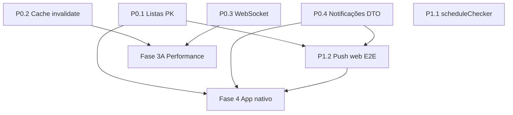

# Roadmap priorizado — Orbe Nerd (FASE 2)

| Campo | Valor |
|--------|--------|
| **Data** | 24/11/2026 |
| **Entrada** | [`docs/auditoria-codigo.md`](auditoria-codigo.md), [`docs/mapa-visao-vs-realidade.md`](mapa-visao-vs-realidade.md) |
| **Escopo deste roadmap** | Ordem de trabalho até **web confiável** + preparação para **app nativo** (Fases 3–4 da sua missão). **Não inclui** implementação — só priorização. |
| **Esforço** | **Pequeno** (dias de foco / poucos arquivos), **Médio** (vários módulos + teste manual), **Grande** (schema, cliente novo, infra). Não são estimativas de calendário. |

**Legenda de prioridade**

- **P0** — Bloqueia confiança, multiusuário, dados frescos ou impede portar para app.  
- **P1** — Necessário para visão README / retenção, mas dá para lançar beta limitado sem tudo.  
- **P2** — Desejável, polish, dívida, produto secundário.

---

## Fase atual sugerida: **P0 (estabilização)** antes de Fase 3 medição larga

Corrigir P0 **muda métricas** de performance (cache stale parece lentidão). Por isso a Fase 3A deve **medir de novo** após P0 crítico (invalidação cache, listas).

---

## P0 — Bloqueia tudo

| # | Item | Esforço | Por quê | Evidência / aceite |
|---|------|---------|---------|-------------------|
| P0.1 | **PK/colunas `WatchlistAnime` e `WatchlistItem`** — id por usuário, não global `cr:…` | **Grande** | Segundo usuário quebra lista | `schema.prisma:863-903`, `buildWatchlistAnimeId` |
| P0.2 | **Invalidação Redis** alinhada a `cache:v{N}:` | **Pequeno** | Sync/admin não atualiza site | `cacheMiddleware` × `cacheInvalidation` |
| P0.3 | **WebSocket** — origens permitidas explícitas | **Pequeno** | Tempo real morto; polling extra | `websocket.ts`, `securityMiddleware.ts` |
| P0.4 | **Contrato notificações** API ↔ frontend (tipos compartilhados ou mapper correto) | **Pequeno** | Modal inútil hoje | `notificationRoutes.ts`, `lib/notifications.ts` |
| P0.5 | **Login:** 401 em `/auth/login` não dispara `session_expired` | **Pequeno** | UX e suporte | `lib/api.ts:122-128` |
| P0.6 | **Redirect extensão** — unificar `next` / `redirect` | **Pequeno** | Fluxo extensão | `extensao/page.tsx`, `login/page.tsx` |
| P0.7 | **Migration RLS** condicional (roles Supabase) | **Médio** | `migrate deploy` local e CI | migration `20260918180000` |
| P0.8 | **`docker-compose` dev** — envs mínimas para API subir | **Pequeno** | Onboarding e QA | `docker-compose.yml` |

**Critério de saída P0:** dois usuários adicionam o mesmo anime do catálogo → ambos 200; após `invalidate-cache`, chaves Redis somem; `wscat` conecta com Origin permitido; modal de notificação mostra texto e data; senha errada mostra erro no login.

---

## P1 — Importante para a visão (web “finalizável”)

| # | Item | Esforço | Por quê |
|---|------|---------|---------|
| P1.1 | **Ligar ou remover `scheduleChecker`** + documentar gatilhos de `Notification` | **Médio** | Promessa de alertas 7d/1d |
| P1.2 | **Push web E2E** — VAPID em prod, subscribe, envio, clique abre rota | **Médio** | Roadmap README + retenção |
| P1.3 | **Curadoria admin vs sync** — colunas `*_curado` ou flag “não sobrescrever” | **Médio** | Confiança de quem edita catálogo |
| P1.4 | **SSR / `getApiOrigin`** — respeitar `NEXT_PUBLIC_API_URL` | **Pequeno** | SEO e first paint |
| P1.5 | **Data dinâmica** em `animeCarouselInclude` | **Pequeno** | Carrossel de animes correto |
| P1.6 | **Service Worker** — matcher `/api/homepage` | **Pequeno** | PWA não cacheia rota errada |
| P1.7 | **Unificar ou depreciar watchlist legada** | **Médio** | Um produto, uma API mental |
| P1.8 | **Minha Lista animes** — QA sem botão demo em prod; encoding UTF-8 nas mensagens | **Pequeno** | Profissionalismo |
| P1.9 | **Extensão** — validar `sender.origin`; limpar token ao trocar `apiUrl` | **Médio** | Segurança |
| P1.10 | **Testes de regressão** — watchlist 2 usuários, notificações, invalidate (supertest mínimo) | **Médio** | Evitar reintroduzir P0 |
| P1.11 | **Deploy** — atualizar `PRODUCAO.md` + checklist vivo (Supabase, Vercel vars) | **Médio** | Roadmap README item 1 |
| P1.12 | **Contrato API** — esboço OpenAPI ou pacote `shared-types` | **Médio** | Pré-requisito app nativo |

---

## P2 — Desejável / adiar sem culpa

| # | Item | Esforço | Nota |
|---|------|---------|------|
| P2.1 | Design **Pulp** 100% em `globals.css` | Médio | Não bloqueia app |
| P2.2 | `/apoie` PIX e tiers | Pequeno–médio | Produto |
| P2.3 | Minha Lista **filmes/séries/jogos** | Grande | Cortar do marketing até P0/P1 animes OK |
| P2.4 | Refresh token, reset senha, exclusão conta | Grande | Lojas e LGPD no app |
| P2.5 | Separar worker de sync/cron do HTTP | Grande | Só se Fase 3 provar gargalo CPU |
| P2.6 | Atualizar `frontend/README`, revisar `orbe-1` | Pequeno | Documentação |
| P2.7 | Comentários / rede social | — | **Não fazer** (descartado) |
| P2.8 | **App nativo** (RN/Flutter/nativo) | Grande | **Fase 4** após P0+P1+plano Fase 3 |
| P2.9 | FCM/APNs + dispositivos no backend | Grande | Fase 3B + 4 |
| P2.10 | CI frontend + e2e no GitLab | Médio | Qualidade contínua |

---

## Sequência recomendada (milestones de produto)

### M1 — “Confiável para 2+ usuários” (só P0)

- Schema + API listas corrigidas  
- Cache invalidate + WS  
- Notificações legíveis + login/extensão  

**Aceite:** checklist manual da FASE 1 passa nos itens 8–11.

### M2 — “Retenção web” (P0 + P1.1–P1.3, P1.7–P1.9)

- Alertas automáticos ou escopo reduzido documentado  
- Push web funcional em staging  
- Extensão segura  
- Uma watchlist canônica  

**Aceite:** usuário recebe push de teste e vê notificação in-app coerente.

### M3 — “Pronto para medir performance” (Fase 3A)

- Baseline Lighthouse, TTFB homepage, tempo `/api/homepage` com/sem Redis  
- Corrigir top 3 causas com evidência  

**Aceite:** documento `plano-performance-notificacoes.md` com antes/depois.

### M4 — “Pronto para decidir stack nativa” (Fase 4)

- OpenAPI ou tipos compartilhados  
- Auth com refresh (se loja/distribuição exigir)  
- Plano de telas: login → home → detalhe → minha lista  

**Aceite:** `plano-portabilidade-app.md` aprovado por você.

---

## Roadmap × sua missão em 4 fases

| Sua fase | Roadmap |
|----------|---------|
| FASE 1 Auditoria | ✅ `auditoria-codigo.md` |
| FASE 2 Mapa + roadmap | ✅ este arquivo + `mapa-visao-vs-realidade.md` |
| FASE 3 Lentidão + notificações | Executar **após M1** (ideal **M2** para push); P0.2 incluso na performance |
| FASE 4 App nativo | **M4+**; não iniciar antes de M1 |

---

## Dependências entre trabalhos

---

## Riscos se pular prioridades

| Se pular… | Risco |
|-----------|--------|
| P0.1 | App nativo replica crash 500 em qualquer lista compartilhada |
| P0.2 | Fase 3 “otimiza” frontend enquanto API serve JSON velho 12h+ |
| P0.4 / P1.2 | Investimento em FCM sem consertar contrato duplica confusão |
| App nativo antes de M1 | WebView ou RN com bugs já conhecidos — frustrante e caro de reverter |

---

## Próximo passo

Com sua **aprovação**, inicio **FASE 3** (somente planejamento + medição **comandos para você rodar**, sem alterar código até você aprovar o plano de correções):

- `docs/plano-performance-notificacoes.md`

Se quiser ajustar prioridades (ex.: performance antes de listas), diga — o roadmap é seu.